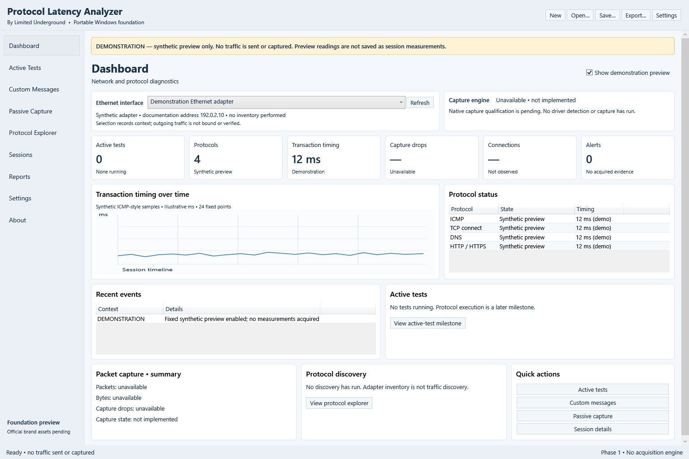

# Protocol Latency Analyzer

**By Limited Underground**

Windows-first portable network diagnostics application, with a reusable core intended for a future Linux application. Phase 1 provides the desktop foundation: dashboard shell, read-only Ethernet inventory, capability reporting, configuration, local sessions, and logging. Protocol transmissions and packet capture are not implemented in this phase.

The dashboard follows the approved information-dense reference. Any demonstration data is synthetic and must be identified as such. Missing live measurements appear unavailable; a backend's presence is not proof of capture capability. Visual styling is provisional pending official brand assets and a theme decision.

## Build and run

Requires Windows and the .NET 10 SDK for development. From the project directory:

```powershell
.\scripts\Build.ps1
.\scripts\Test.ps1
dotnet run --project .\src\ProtocolLatencyAnalyzer.Desktop
.\scripts\Publish.ps1
.\scripts\Verify-Package.ps1
```

The test project is a console-based foundation test runner. Publish artifacts are written beneath `.artifacts`. Publishing and verification preserve existing outputs; use matching `-OutputName win-x64-review2` arguments for a fresh candidate. The verification script checks the ZIP checksum, extracts it into a new project-local directory, then runs synthetic layout, storage, and render checks without interface inventory or network acquisition. Verification has a 60-second timeout per process.

The intended distribution is a self-contained Windows x64 portable package using .NET/WPF 10.0.13; it should not require a separately installed .NET runtime. Normal-build and Windows-runtime package locks are separate. Actual package and operating-system validation is recorded in [Phase 1 acceptance](docs/PHASE1_ACCEPTANCE.md). An SDK build or offscreen render does not establish interactive workflow or all-OS acceptance.

## Data and privacy

Choose a writable data location explicitly when saving a session. Configuration files are explicitly saved/loaded; no configuration is silently loaded on startup. Diagnostics are fixed-message, bounded, memory-only operation records. Session metadata may contain interface identifiers; protect saved files and deliberate exports appropriately. Storage failures produce a clear error rather than a silent relocation. No capture, protocol traffic, automatic telemetry, or cloud upload is part of Phase 1. Do not save credentials or private captures into this source tree.

## Structure and status

- `src/ProtocolLatencyAnalyzer.Core`: platform-neutral contracts and models.
- `src/ProtocolLatencyAnalyzer.Infrastructure`: JSON configuration, SQLite sessions, and read-only Ethernet inventory.
- `src/ProtocolLatencyAnalyzer.Desktop`: WPF dashboard, interaction, and platform presentation.
- `tests/ProtocolLatencyAnalyzer.Tests`: foundation verification.
- `docs`: assessment, decisions, roadmap, and acceptance evidence.

Windows 11 and Server 2019/2022/2025 are target platforms, not a completed validation claim. Linux is future work; WPF itself is Windows-only. macOS has no current commitment. Phase 1 source and documentation are published in the [public repository](https://github.com/Limited-Underground/ProtocolLatencyAnalyzer), with progress in the [private Project](https://github.com/orgs/Limited-Underground/projects/2). Source publication does not constitute a release or website publication. See [GitHub setup](docs/GITHUB_SETUP.md).

Application license: **Apache-2.0**, selected by the owner. Third-party components retain their own licenses; review the resolved dependency graph and notices before distribution.

Start with [architecture](docs/ARCHITECTURE_PROPOSAL.md), [decisions](docs/DECISION_LOG.md), and [roadmap](docs/ROADMAP.md). Historical intake files are retained locally and excluded from publication. The decision log records the current owner-approved direction.

## Phase 1 preview



The preview was rendered by the packaged WPF application. No protocol traffic or capture produced these readings. See the [sanitized host evidence](docs/validation/PHASE1_HOST_RESULTS.json) and [acceptance checklist](docs/PHASE1_ACCEPTANCE.md) for passed checks and outstanding testing. Local ZIPs and caches are not included in the source repository; reproduce them with the scripts above.
