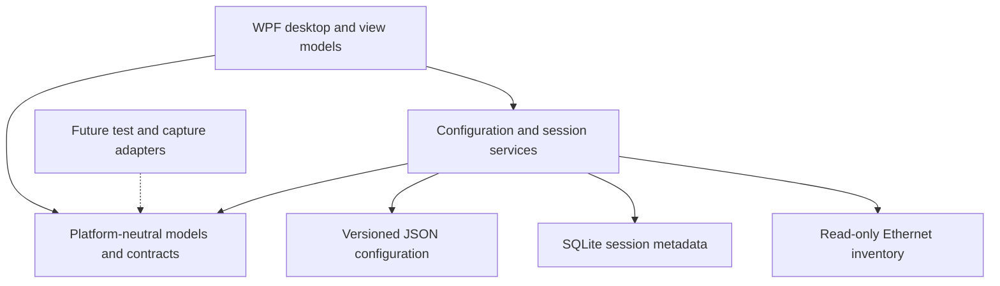

# Architecture

Windows-first .NET 10/WPF desktop foundation with a reusable non-WPF core. A future Linux application will need its own UI, platform integration, packaging, and validation.

## Boundaries

`Core` must not reference WPF, Windows APIs, UI dispatchers, registry facilities, capture drivers, or platform-specific secrets. Keep serializable session context and measurement-validity concepts here. `Infrastructure` implements persistence and current read-only adapter inventory. Keep adapter enumeration behind a contract so future platform adapters can replace it. `Desktop` owns dialogs, dispatcher interaction, visual resources, commands, and presentation.

Custom MVVM avoids a toolkit dependency in the foundation. Microsoft.Data.Sqlite is the selected structured storage provider; its resolved managed/native dependencies need inventory and notices before distribution. JSON is appropriate for small versioned configuration, while SQLite supports transactional session metadata. Raw capture retention is a later independent concern.

## Foundation behavior

Use stable Ethernet identifiers rather than enumeration order. Selecting an adapter is context, not proof of active-traffic routing. Capability states must explain unavailable implementation, missing privilege, unsupported platform, and untested behavior distinctly. Phase 1 must not probe a target or start capture.

Use explicit writable storage selection, atomic configuration replacement, version checking, bounded event/history collections, sanitized logs, and clear recoverable errors. Do not silently overwrite an unsupported schema. Session evidence must retain whether it is synthetic and what was unavailable. UI rendering must not define measurement timing.

## Later integrations

Active tests require finite concurrency, cancellation, and monotonic elapsed timing. Capture adapters require explicit payload/timestamp/drop capabilities, bounded decoding/reassembly, and privilege separation. An on-demand helper may be appropriate after backend proof; no helper or privileged operation is necessary for the current foundation. No permanent service or local web server is required.

Portable publication initially uses self-contained win-x64 output and support files. Single-file extraction, signing, clean-machine behavior, cross-OS runtime/native compatibility, and final support boundaries require separate evidence.

References: [WPF overview](https://learn.microsoft.com/en-us/dotnet/desktop/wpf/overview/), [.NET 10 OS matrix](https://github.com/dotnet/core/blob/main/release-notes/10.0/supported-os.md), [SQLite native dependencies](https://learn.microsoft.com/en-us/dotnet/standard/data/sqlite/custom-versions), [single-file deployment](https://learn.microsoft.com/en-us/dotnet/core/deploying/single-file/overview).
